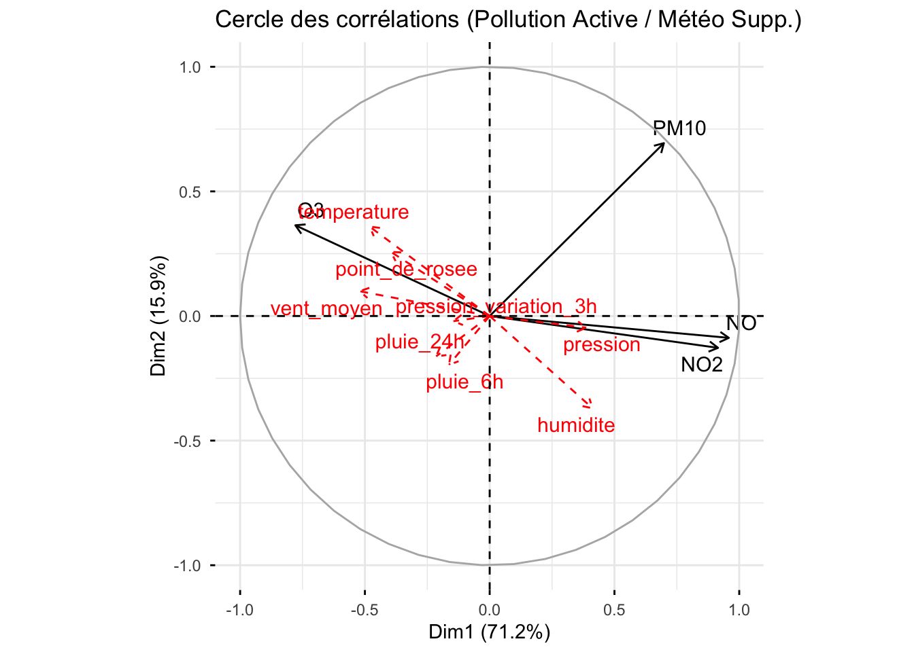

# Air Quality in Périgueux: Principal Component Analysis

Multivariate analysis of one year of hourly air pollution and weather data in Périgueux, France (November 2023 – October 2024). Course project (Master IREF, University of Bordeaux, 2025), with Dorian Fernandez.



## Key results

- On daily averages, two axes explain **87%** of pollution variance. Axis 1 (71%) opposes traffic gases (NO, NO2) to ozone, and axis 2 (16%) isolates fine particles (PM10).
- Ozone rises with temperature and wind, and falls with humidity and nitrogen oxides, which destroy it.
- At weekends, median NO drops by 30% and NO2 by 20%, while ozone stays almost unchanged (−5%).
- Winter weekends trade traffic pollution for particles: NO and NO2 still fall, but PM10 rises slightly (+6%) instead of falling as in the rest of the year, consistent with residential heating.

## Method

1. **Correlation analysis:** full-day and noon-only correlation matrices.
2. **Normed PCA on hourly data:** interpretation of the axes, extreme heat episodes, comparison between noon and 6 pm.
3. **PCA on daily averages:** pollutants as active variables with weather as supplementary variables, then the reverse.
4. **Weekday vs weekend:** boxplots, then projection of weekdays and weekends on the PCA, by season and at rush hours.

## Repository

| Path | Content |
|---|---|
| `RDSM_Projet.Rmd` | Full analysis (R Markdown, in French) |
| `RDSM_Projet.html` | Rendered report ([view in browser](https://htmlpreview.github.io/?https://github.com/VianneyMathon/Air-quality-PCA-R/blob/main/RDSM_Projet.html)) |
| `data/ATMO-RDSM2.rda` | Hourly pollution and weather data for Périgueux, provided for the course |

## Run

R ≥ 4.0 with `tidyr`, `dplyr`, `ggplot2`, `lubridate`, `plotly`, `MASS`, `FactoMineR`, `factoextra`, `corrplot`, `naniar`.

```r
rmarkdown::render("RDSM_Projet.Rmd")
```
